<p align="center">
  
</p>

<h1 align="center">Daedalus</h1>

<p align="center">
Parametric desktop CAD with an AI modelling copilot.<br>
Python · Qt (PySide6) · OpenCASCADE (build123d / OCP) · VTK
</p>

<p align="center"><b>v3.0.43</b> · Windows (also runs on Linux/macOS) · <a href="#version-history">Version history</a></p>

<p align="center">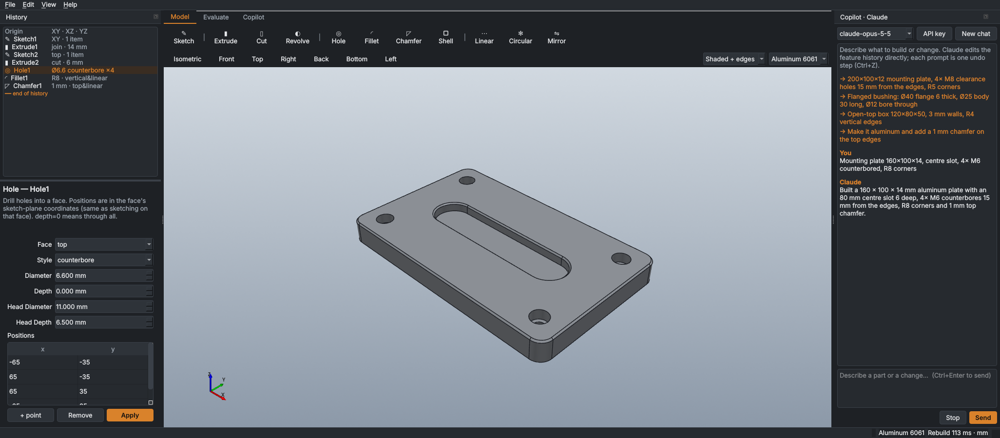</p>

Daedalus covers the full path from sketch to shop floor: parts, assemblies, drawings, sheet metal, frames and HSS,
simulation (FEA, CFD, physics), production drawings to ISO and ASME, CAM with G-code, quoting, purchase orders and
inventory (DIMS, shared by the whole shop on a team server). **Icarus**, the built-in copilot, models through the
same feature tools you use. It runs locally on Ollama (any model) by default, on any OpenAI-compatible server (GPT, LM
Studio, Jan, OpenRouter…), on Claude with an API key, or on your own Claude, ChatGPT or Gemini plan. **Claude Desktop**,
**ChatGPT desktop** and other AI apps can use the same tools in your open window. Daedalus also links to SolidWorks, Fusion, Rhino, Inventor and Solid Edge.

Files save as `.daedalus` (JSON feature history). Formerly **Strata CAD**: `.strata` files open as before, and
settings are migrated on first launch.

---

## Highlights

| | |
|---|---|
| 🤖 **AI copilot (Icarus)** | Describe a part and Icarus builds it with the same feature tools you use, as editable history. Runs free on local Ollama (any model), on GPT, LM Studio and other OpenAI-compatible servers, on Claude, or on your own Claude, ChatGPT or Gemini plan. One prompt is one undo step. Reads photos, drawings, PDFs and spreadsheets. |
| 💬 **Claude Desktop, ChatGPT & more** | Claude Desktop, ChatGPT desktop / Codex, Gemini CLI, LM Studio, Cursor and VS Code get all 168 Daedalus tools and work in your open window — and, with CAD Link open, in SolidWorks, Fusion, Inventor, Solid Edge or Rhino, moving parts and BOMs between them and DIMS. |
| 📐 **Full parametric modelling** | Constrained sketches, 3D sketches, 40+ feature types, configurations and equations, surfaces, sheet metal with flat patterns. |
| 🏗️ **Frames and HSS** | Frames along a 3D sketch; the HSS builder covers AISC, CSA and EN sizes or any custom size; section properties; cut lists with weights. |
| ⚙️ **Assemblies that move** | Standard, advanced and mechanical mates (gear, rack, screw, cam, slot), subassemblies, and MuJoCo physics with motors, springs and contact. |
| 🔬 **Simulation built in** | FEA (static, frequency, buckling, thermal, fatigue, harmonic), assembly FEA with bolts, drop tests, CFD through the ports you choose, topology optimisation, design studies. |
| 📄 **Production drawings** | Sheet formats (ISO 5457, ASME Y14.1 or your own), dimensioning standards (ISO 129, ASME Y14.5, DIN, JIS, BS), seven section types, GD&T, notes, drawing numbers, revision tables. Export to PDF, DXF and DWG. |
| 🛠️ **Shop-floor ready** | Auto CAM builds the whole program and writes G-code (Fanuc, Haas, Siemens, LinuxCNC, GRBL). Also a backplot, quoting and a machine schedule. |
| 📏 **Units for engineering and construction** | SI, US customary and ft-in fractions. Type any unit into any field (`3' 4-1/2"`, `25 mm`, `4/12`). The Measure panel works in your units. |
| 🔗 **Works with your CAD** | Links with SolidWorks, Fusion, Rhino, Inventor and Solid Edge. Opens STEP assemblies of 1,600+ parts in seconds. |
| 📦 **BOM and inventory** | Standard parts library with duplicate detection; DIMS (Daedalus Inventory Management System): projects, orders, production, reorder, purchase orders as PDF, team chat; Send BOM turns a design into a project with stock and shortfalls. |
| 📑 **PDF tools** | Open, combine, split, reorder and mark up PDFs; read drawing PDFs (title block, BOM, revisions) straight into DIMS. |
| 📘 **Design data** | 27 machine-design calculators (shafts, gears, keys, brakes, fatigue…) and search across your own handbooks. |

<table>
<tr>
<td align="center">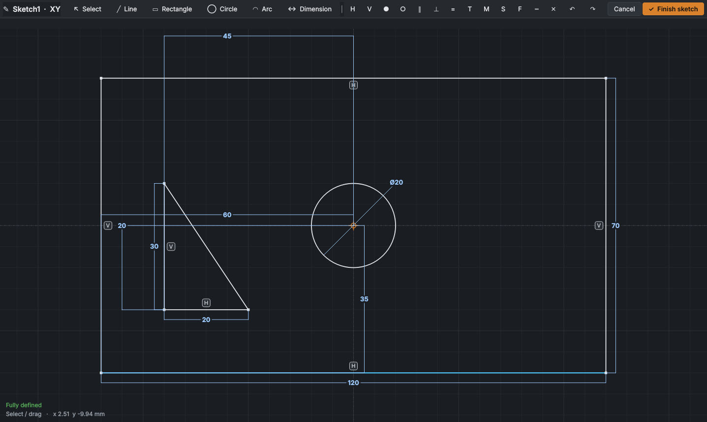<br><sub>Constrained sketcher</sub></td>
<td align="center">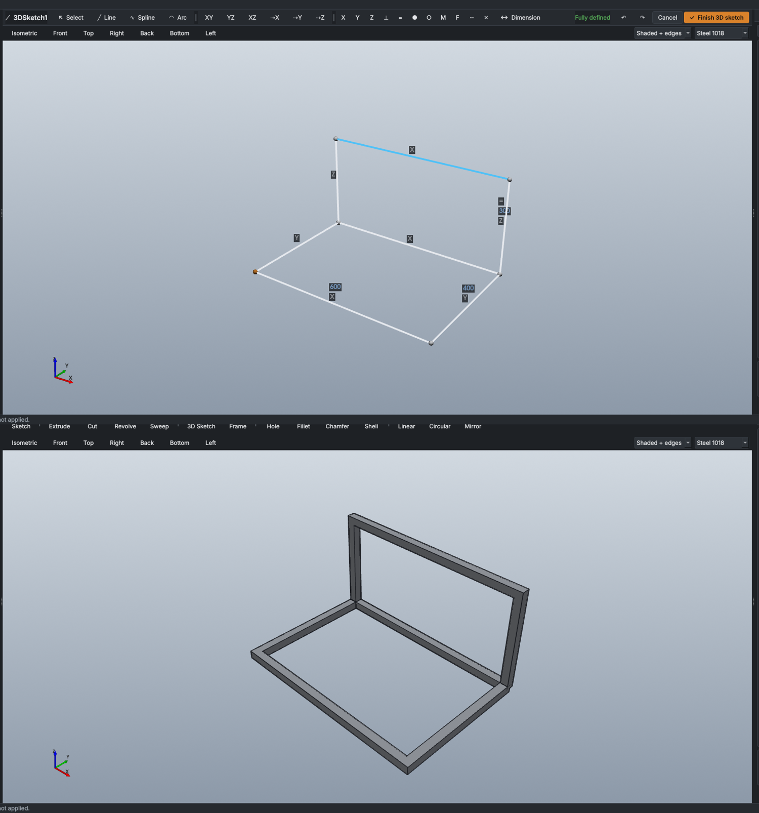<br><sub>3D sketch → frame</sub></td>
<td align="center">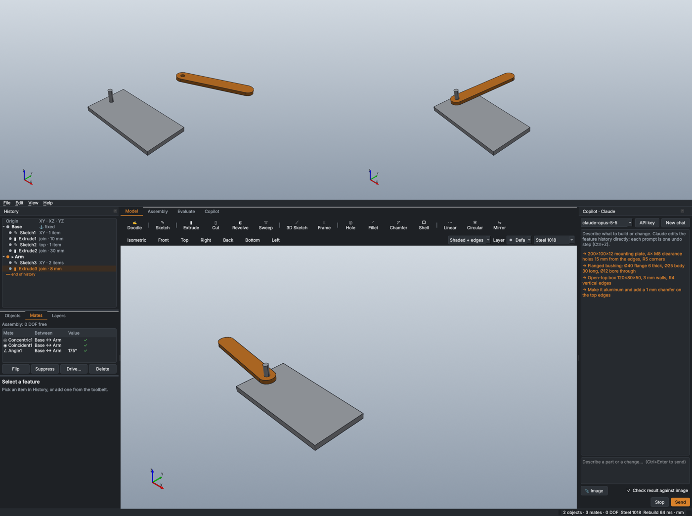<br><sub>Mates and motion</sub></td>
</tr>
<tr>
<td align="center">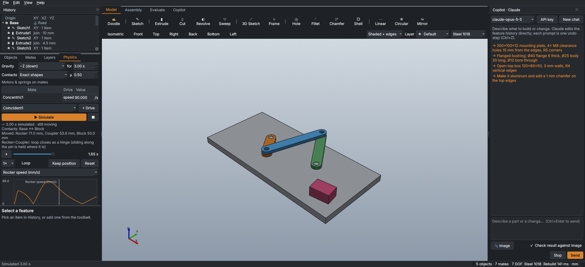<br><sub>Physics simulation</sub></td>
<td align="center">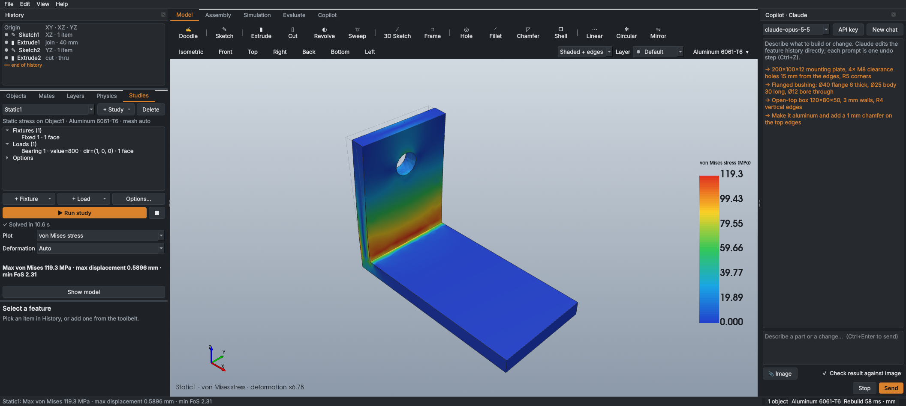<br><sub>Static FEA</sub></td>
<td align="center">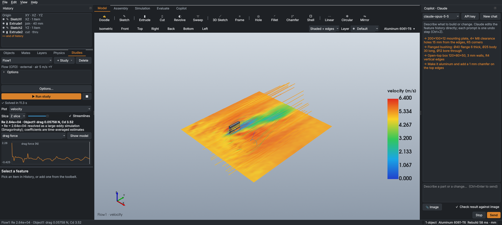<br><sub>CFD flow</sub></td>
</tr>
<tr>
<td align="center">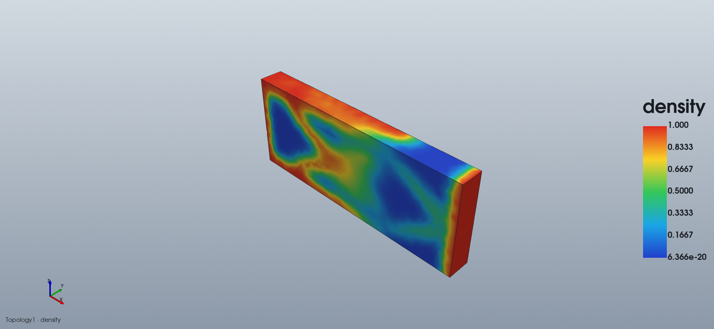<br><sub>Topology optimisation</sub></td>
<td align="center">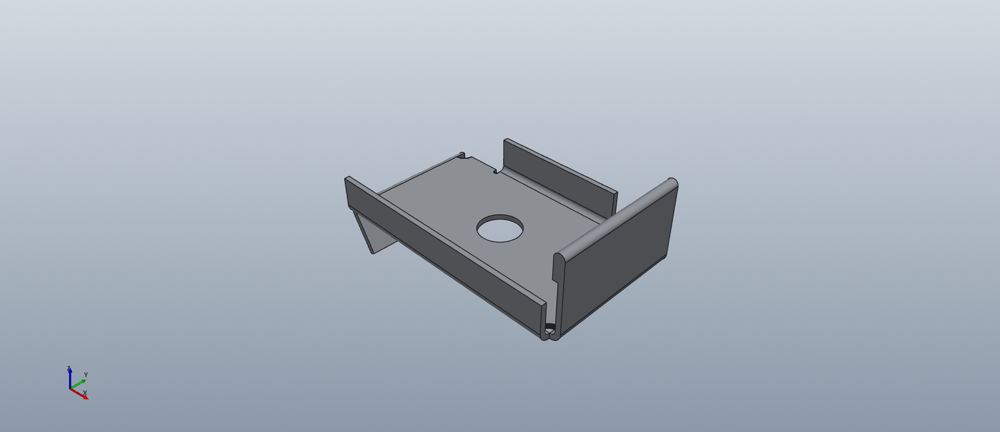<br><sub>Sheet metal</sub></td>
<td align="center">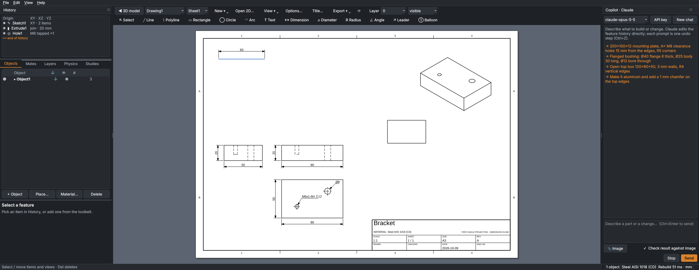<br><sub>2D drawings</sub></td>
</tr>
<tr>
<td align="center">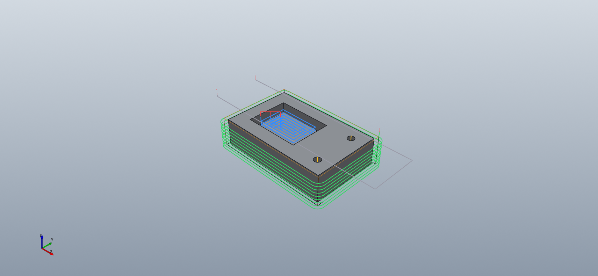<br><sub>CAM toolpaths</sub></td>
<td align="center">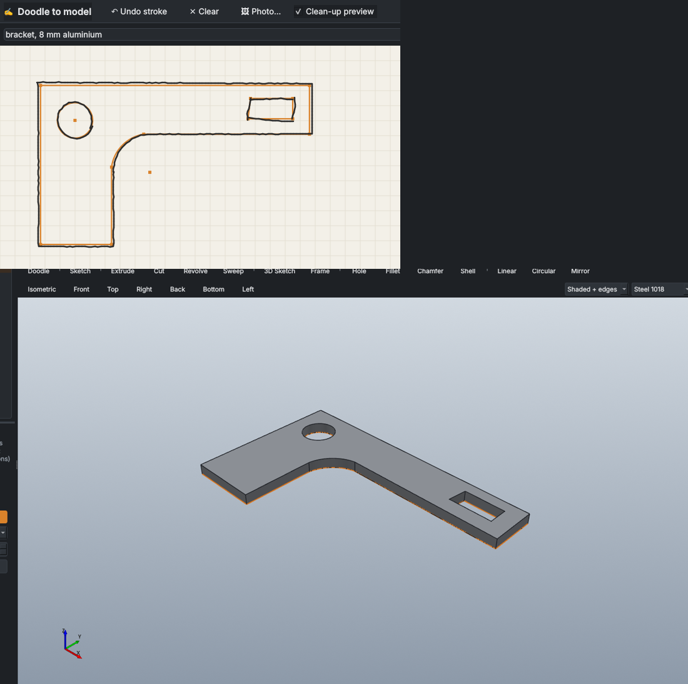<br><sub>Doodle → model</sub></td>
<td align="center">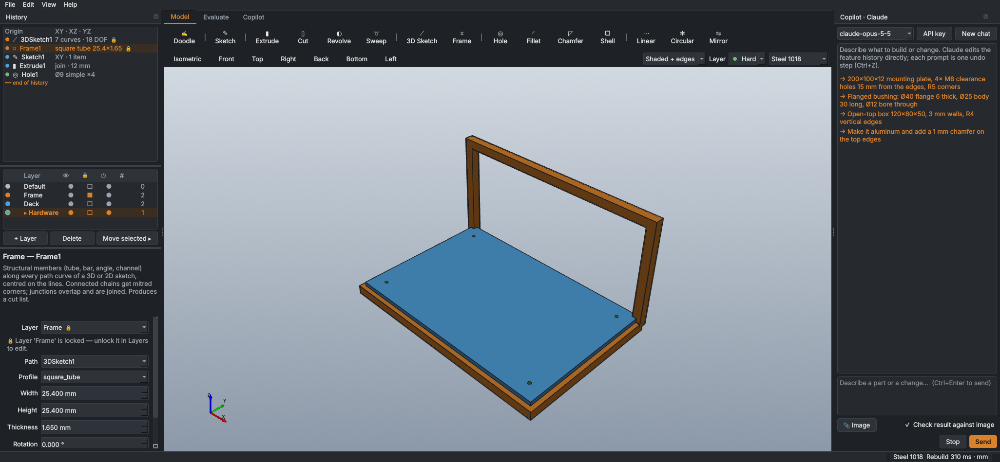<br><sub>Layers</sub></td>
</tr>
</table>

<sub>Screenshots are from earlier versions; the current interface uses the teal theme.</sub>

---

## Contents
[Highlights](#highlights) · [Install](#install) · [Features](#features) · [Icarus copilot](#icarus-copilot) · [Claude Desktop](#claude-desktop) · [CAD Link](#cad-link) ·
[Keys & mouse](#keys--mouse) · [Tips](#tips) · [Architecture](#architecture) · [Development](#development) ·
[Version history](#version-history) · [Roadmap](#roadmap) · [License](#license)

---

## Install

**Windows (recommended):** unzip, then double-click **`install.bat`**. It:
1. Finds or installs **Python 3.11 64-bit** for the current user. The sketch solver ships Windows wheels for 3.10/3.11 only.
2. Builds `.venv`, installs the requirements and pre-compiles the code.
3. Adds Desktop and Start-menu shortcuts.
4. Sets up Icarus: installs and starts Ollama, then downloads a model that fits your NVIDIA graphics card (12 GB+ →
   `qwen2.5:14b`, 6 GB+ → 7b, else 3b) and your RAM. Without an NVIDIA card it picks at most the 7b.

Installer options: `-NoAgent`, `-AgentOnly`, `-Model <name>`, `-NoShortcut`, `-Yes`, `-CheckOnly`.
After installing, start Daedalus from the shortcut or with `run_windows.bat`.

**Manual install (any OS):**
```bash
py -3.11 -m venv .venv              # macOS/Linux: python3.11 -m venv .venv
.venv\Scripts\activate              # macOS/Linux: source .venv/bin/activate
pip install -r requirements.txt
pip install -r requirements-optional.txt   # CoACD (exact physics shapes), pywin32 (CAD Link) — optional
python -m daedalus                  # or: python -m daedalus part.daedalus
```

**Startup modules:** Daedalus can load only the parts you need.

| Command | Opens | Loads the CAD kernel? |
|---|---|---|
| `python -m daedalus` | Everything (or your saved choice) | Yes |
| `--only 3d` | Modelling, assemblies, CAM, Icarus | Yes |
| `--only sim` | 3D view with the Simulation and Evaluate tools; modelling tools hidden | Yes |
| `--only drawing` | 2D drawings: DXF/DWG/SVG/HPGL editing, blank sheets, title blocks, export | No (~1 s start) |
| `--only inventory` | DIMS inventory | No (~1 s start) |
| `--only drawing,inventory` | Both, as tabs | No |

- **Saving a choice:** Help ▸ Startup modules… saves the set to use when no flag is given.
- **Shortcuts:** the installer adds Start ▸ Daedalus ▸ 3D / Simulation / Drawings / Inventory.
- **From the light window:** File ▸ Open 3D workspace loads the rest when you need it.
- **Model views:** the drawings module on its own can't create views of a 3D model. It can still open the drawings saved in a `.daedalus` file.

**Setup check:** run `python -m daedalus --check` (add `--json` for machine-readable output), or open
**Help ▸ Setup check**. It installs missing packages, starts Ollama and downloads models.

**Updates:** each start checks GitHub (`ayenn1214/daedalus`) at most once a day; a status-bar button appears when a
newer version is out (a running Daedalus checks again every 2 h). **Help ▸ Check for updates…** checks now. The update
window lists what's new in every version between yours and the latest.
- **Channels:** *Releases* (default, follows GitHub Releases / `v*` tags) or *Every commit on main* (testing).
- **Git checkout:** updates with `git pull` (refused if you have local edits). **Zip / installer copy:** downloads,
  closes, swaps the files (settings, data and `.venv` untouched), runs `pip install` if requirements changed,
  restarts. Replaced files go to `.update/backup-<version>` — Help ▸ Check for updates ▸ Roll back.
- **Private fork:** set `DAEDALUS_GITHUB_TOKEN`. Skip a version or turn the start check off in the update dialog.

**DIMS team server:** Inventory ▸ Where the data lives ▸ Team server. Paste `supabase/migrations/20261112000000_dims.sql`
into Supabase ▸ SQL Editor (or click *Copy DIMS setup SQL*) — one row per record, stock moved by a database trigger,
roles (admin / editor / floor / viewer, first sign-in is admin), audit trail, row-level security. Old web-app data
imports with one click; servers without the tables keep working in the old single-table mode.

**DIMS as an MRP-lite**
- **Part numbers** (Engineering ▸ Part Numbers): the shop structure — `C10` machined part, `C20` sub-assembly /
  weldment, `C30` top-level assembly (letter = product line), `P00`–`P04`… purchased by category, `1000-001`
  purchased material. Type a prefix, get the next free number, reserve a block for a project, then create the
  profile or assign it to a part. Lists every number in use with who created it and when. On the team server the
  database hands numbers out, so two people never get the same one (needs `20261113000000_dims_mrp.sql`).
- **Item profile:** number, description, revision, primary / secondary / alternate vendor with vendor part #,
  price, quoted / last / average lead time, bin, stock, thumbnail, creator, order history, where used.
- **BOM workbench:** build multi-level BOMs from profiled parts (assembly or weldment), level checks
  (a C20 can't sit inside a C10), rolled-up cost; raw material and surface finish per fabricated part.
- **Job order & kit:** explode a build quantity, net of stock, and route each line to who supplies it — one PO
  draft per vendor (Excel with vendor address / contact), logged as part orders, plus a pick list by bin.
- **Material needs:** raw material for open production orders or active projects, for buying and bulk-buy
  comparisons. **Where used:** what each part goes into, shared vs unique.
- **Vendors:** full directory (address, contact, account, terms) — import from Excel; vendor prices import from a
  spreadsheet (e.g. the pricing Google Sheet saved as .xlsx).
- **Time-Phased:** incoming orders by week and where they're going, projected stock with the date each part runs
  short, and the order log (ordered / received / binned / shipped).

**DIMS projects, orders and production**
- **Projects:** one table per project, grouped MFG / Purchased / Fasteners / Other; weldments nested with their parts
  (or flat / hidden). Parts inside a project part's BOM — weldment pieces, sub-weldments, assembly parts, any depth —
  belong to that project; a weldment used by several projects is the same part on all of them. **Unassigned** lists
  parts on no project (right-click → Assign to project / + New project…).
- **Project Profile:** 3D preview of the linked STEP / STL (drag to turn, View ▾ / Orient ▾), overall size, weight and
  budget rolled up through the BOM, longest lead, options and what each adds, vendors with open POs, drawing revisions.
- **Project customizer:** pick-one options and add-ons per project. **Orders ▸ + Add…** configures each line: qty per
  unit of the project's top-level MFG parts plus custom options; confirmed orders create demand and production.
- **Production:** production inbox (unread per person), PO checklist by vendor (fasteners, powder coat, zinc,
  purchased), production Gantt and dates, finishing (zinc $/lb × weight, powder-coat quotes).
- **Buy List ▸ Create PO…** (also the Dashboard's company profile card): purchase order PDFs per vendor with your
  company details and logo, PO numbering, editable lines; the parts are marked as ordered. Generic, for any company.
- **Team chat:** team room, direct messages and group chats (members only, enforced on the server); Shift-click
  anything in DIMS to drop a live link to it into the chat; pop the chat out into its own window.
- **Activity log ▸ Updates:** every part profile change (who, when, old → new); parts changed in the last 7 days are
  highlighted.
- **Speed:** team-server saves go up in the background, several records at once, so the window never waits.

**DIMS extras**
- **Analytics tab:** usage trends (months of stock left, run-out date, suggested reorder point), cost analysis
  (stock value by type / vendor / category / rack, project cost per unit), vendor price cross-reference (cheapest
  quote, savings per year), production history (date range; completion dates from the team server's audit trail),
  discontinued parts. Every report exports to Excel.
- **Parts:** sort and filter by vendor, part pictures and wireframe thumbnails of 3D models (STL / STEP /
  .daedalus; SolidWorks files show their saved preview), discontinued parts with a replacement (never reordered).
- **Read drawings…** (Parts tab, or File ▸ Read into DIMS… in the PDF window): reads drawing PDFs — title block
  (part number, description, revision, weight, material, finish, drawn by / date, scale), BOM table, revision table
  and notes — straight from the PDF's text (OCR with Tesseract for scans). Each drawing is matched to DIMS by part
  number; for an existing part you tick what to add to its profile, new parts can be created, and the BOM can set a
  weldment's parts.
- **MFG revisions…** checks manufactured parts against their model and drawing files: a higher "Rev" file in the
  folder, a file saved since it was checked in, or a revision letter that doesn't match.
- **Locations ▸ Print binning list:** every bin with its parts and stock, with a blank Count column — print, PDF
  or Excel.
- **Icarus in DIMS:** the ✦ Icarus button opens a chat that reads the inventory and, when asked, records stock,
  counts, orders, projects, production orders, revisions and discontinued parts (each change can be undone). The
  3D workspace's Icarus has the same inventory tools.
- **Tables like a spreadsheet:** drag or double-click column edges, right-click to autofit, resize or hide columns,
  click a header to sort; row height, spacing, grid lines and text size in Settings ▸ DIMS.
- **Report bug** (also Help ▸ Report a bug…): a short form plus system details, sent as an email to the team
  contact, a GitHub issue, or copied / saved with a screenshot. Crashes are saved and offered as a report at the next
  start (Help ▸ Crash reports folder).

**Optional extras**
- **DWG:** install the free ODA File Converter; Daedalus finds it automatically. DXF, PDF, SVG and STEP need nothing extra.
- **Scanned handbooks:** install Tesseract OCR to add them to the Design Data reference library.
- **Claude:** click **API key** in the Icarus panel, or set `ANTHROPIC_API_KEY`. The model defaults to `claude-opus-5-5` (`DAEDALUS_MODEL` overrides it).

---

## Features

### Modelling
- **Feature history:** rollback bar, suppress, reorder, rename (references follow), and per-feature error isolation.
  Incremental rebuild means only features from the edit point down re-run.
- **Sketcher:**
  - Entities: lines, rectangles (5 kinds), slots (4), circles, arcs, polygons, ellipses, conics, splines, points, text with property fields, equation-driven curves.
  - Relations, smart dimensions, live solving, and DOF colouring.
  - Snaps that add relations automatically.
  - Tools: trim, extend, offset, fillet, chamfer, split, mirror, patterns, convert edges, move/rotate/scale, belt/chain.
- **3D sketch:** lines, splines and arcs on any plane or along X/Y/Z, with 3D snaps, relations and dimensions.
- **Features:**
  - Extrude (seven end conditions, two directions, draft), revolve, sweep (Frenet), loft, rib, draft, shell.
  - Hole wizard (M3–M24, #4-40–3/4-10), cosmetic and modelled threads.
  - Fillets (constant, variable, face, full-round) and chamfers (distance, distance-distance, distance-angle, vertex).
  - Linear, circular and mirror patterns; reference planes and axes.
- **Curves and surfaces:**
  - Curves: helix, spiral, spring, XYZ curve, projected and composite curves.
  - Surfaces: extruded, revolved, lofted, planar, offset and filled surfaces; knit, thicken, delete face.
- **Configurations and equations:** global variables, equations driving any parameter or sketch dimension, and a design table (.xlsx/.csv).
- **Sheet metal:**
  - Base and edge flanges, miter flanges, hems, sketched bends.
  - Gauge tables; K-factor, bend allowance or bend deduction; reliefs.
  - Forming tools (dimple, rib, louver, extruded hole).
  - Convert a shelled solid to sheet metal; fold/unfold; flat pattern to DXF.
- **Frames and HSS:**
  - Members along a 3D sketch, with mitred chains, coped T-joints, end caps, gussets, and a cut list with weights.
  - **HSS builder:**
    - Sizes: AISC/A500, CSA G40.20/21, EN 10219/10210, or any custom size and corner radius.
    - Section properties (A, I, S, Z, r, J) are within 1–2 % of the AISC Manual.
    - Inserts as a straight member or a frame.
- **Doodle to model:** draw or photograph a rough sketch, and Daedalus turns it into a constrained sketch offline, or Icarus models it.
- **Layers:** colour, visibility, lock and in-model flags per layer.

### Units and measure
- **Unit systems:**
  - SI: MMGS, mm·kg·N·MPa, MKS, CGS.
  - US customary: inch, fractional inch, foot.
  - Construction:
    - ft-in-fraction (`5'-6 1/4"`, slopes as x/12, plf, psf, kips, yd³);
    - decimal feet;
    - metric construction.
- **30+ measurement types**, each with its own unit, decimals and fraction rounding.
  You can switch in the status bar or under Edit ▸ Units, and there's a built-in unit converter.
- **Any field takes any unit or an expression:** `3' 4-1/2"`, `1/2"`, `25 mm + 2`, `45°`, `4/12`, `72°F`.
  Geometry is always stored exactly.
- **Measure panel:**
  - Points: distance, ΔX/ΔY/ΔZ, plan length, rise, slope.
  - Entities:
    - One edge or face: length, radius, arc angle, area, perimeter, tilt.
    - Two picks: min, centre, max and normal distance, plus angles.
    - More picks: totals.
  - Bodies: mass, weight, centre of mass, board feet.

### Assemblies
- **Objects and mates:** multiple bodies per file, each with its own history.
  - Standard mates: coincident, distance, parallel, perpendicular, angle, concentric, hinge, lock, tangent.
  - Advanced mates: limit distance and angle, width, symmetric, path.
  - Mechanical mates: gear, rack, screw, cam, slot.
  - Mates store geometry, not face numbers, so they survive design changes.
- **Subassemblies** (rigid or flexible, nested) and **component patterns** (linear, circular, mirror).
- **Moving parts:** Move (with snapping and SmartMates), rotate, turntable, orient, drop to floor, Drive a mate, interference check, exploded view.
- **Physics** (MuJoCo):
  - Gravity, contact and friction; mates become joints.
  - Motors, servos and springs.
  - Exact convex-piece collision shapes; playback with traces; "Keep position" writes a frame back to the model.

### Simulation
- **FEA** (quadratic tets, gmsh and scikit-fem):
  - Static, frequency, buckling, thermal (steady and transient), fatigue and harmonic studies.
  - Assembly static with bolt connectors; drop test; topology optimisation; design studies.
  - Checked against beam, column, torsion and conduction theory to within 1–6 %.
- **CFD** (lattice-Boltzmann, Smagorinsky LES at high Reynolds numbers):
  - External flow: drag, lift and drag coefficient.
  - Internal flow end to end, or through the openings you choose: **Find openings** lists the part's ports and bores;
    pick the inlet (e.g. a side port) and the outlets, or let every other opening be one. Walls thinner than a cell
    stay sealed.
  - Results: pressure drop, flow rate, mass flow, the split between outlets, peak velocity; moving slices and
    streamlines from the inlet.
- **Materials:** 60+ standard engineering materials with full properties, plus custom and per-object materials.
- **Design data:**
  - 27 machine-design calculators: shafts, keys, gears, couplings, clutches, brakes, fatigue, columns, contact, cylinders.
  - A searchable reference library for your own handbooks (OCR for scans).

### Drawings
- **Sheets:** A4–A0, Letter–ANSI E or a custom size; first- or third-angle projection; automatic views with hidden lines.
- **Sheet format** (Sheet ▾ ▸ Sheet format): ISO 5457 (20 mm filing margin), ASME Y14.1, Compact, or your own —
  margins, zones, frame weight, and the title block's rows and cells with your own labels and a logo. Save a format
  as a template for every drawing.
- **Title block:** title, company, drawing number, material, mass; drawn / checked / approved / issued with dates;
  scale, size, sheet *n* of *N*, revision, units, general tolerances, surface finish, the projection symbol, and the
  Daedalus version, file and source. Blank fields are filled in where Daedalus can.
- **Dimensioning standards** (Sheet ▾ ▸ Dimensioning standard): ISO 129-1, ASME Y14.5 (inch, metric, dual mm [in]),
  DIN 406, JIS Z 8317, BS 8888 — decimal sign, leading zero (0.5 / .500), trailing zeros, aligned or unidirectional
  text, decimal or DMS angles. Per dimension: reference (in brackets), not to scale (underlined), incomplete (double
  arrowhead), tolerance, dual units. Chain and baseline dimension sets.
- **Views:** projected, isometric, dimetric, trimetric, oblique, detail, auxiliary, broken, flat-pattern and exploded
  (with explode lines).
- **Sections:** full, half, offset, aligned, removed and revolved section views, and broken-out sections in any
  view; cutting-plane lines with arrows and letters; no hidden lines in sections; hatch pattern by material, adjacent
  parts hatched opposite ways; bolts, nuts, pins and shafts left uncut (optional).
- **Notes:** numbered notes in the lower left, with templates (units, tolerances, heat treatment, welding, plating,
  inspection, fastener torque, deburr, paint…).
- **Drawing numbers** (Sheet ▾ ▸ Drawing numbers): XXXXX for the main assembly, XXXXX.AA for subassemblies,
  XXXXX.AA.BB for their parts — base, prefix / suffix, separator, digits per level, start, step, zero padding,
  ordering and depth are yours to set. Standard parts get none. Numbers go into the title blocks and a DWG NO.
  column in the parts list.
- **Annotation:** dimensions (including ordinate), hole callouts, GD&T frames, datums, surface finish, balloons,
  parts list, revision table.
- Export to vector PDF, DXF (R12–R2018), SVG, PNG and DWG.
- Edit DXF, DWG, SVG and HPGL files directly.

### PDF
- **Open PDFs natively:** File ▸ PDF ▸ Open PDF… (Ctrl+Alt+O), File ▸ Open, drag a PDF in, `python -m daedalus file.pdf`,
  or the PDF window on its own: `python -m daedalus --pdf [file]` (Start ▸ Daedalus ▸ Daedalus PDF).
- **Combine:** File ▸ PDF ▸ Combine PDFs…, *Add files…* in the PDF window, or drop PDFs on it — pages go after the selection.
- **Pages:** drag thumbnails to reorder; rotate, delete, duplicate, insert blank, move up/down, reverse; extract the
  selected pages or split (every page, every N pages, or by ranges).
- **Mark up:** text, highlight, box, arrow, line, freehand pen, cover (white box) and signature / image; select to move,
  Delete to remove, double-click text to edit. Undo / redo for everything.
- **Save** writes the pages and draws the mark-ups into them, so any viewer shows them. Also find text, go to page,
  zoom / fit width, print, properties. The original file is only changed when you save over it.

### Manufacturing
- **CAM:**
  - 2.5D operations: facing, pockets, profiles, spot, drill and tap.
  - Canned cycles: G73/74/76/81–89.
  - Posts: Fanuc, Haas, LinuxCNC, GRBL, Siemens 840D.
  - Machine from any side; cycle-time estimates.
- **Auto CAM:**
  - Analyses the part: holes, pockets, inside corners, reachable sides.
  - Picks tools from your lists and writes the whole program, including a second setup.
- **G-code backplot** for any `.nc`/`.tap`/`.mpf` file.
- **Quote:**
  - Machining and sheet/laser quotes from the exact model, with quantity breaks.
  - Machine schedule and quote history.
- **Manufacturability checks:** draft and undercut, wall thickness, 3D-print overhang.

### Data and files
- **Import:**
  - STEP assemblies (large files read in the background; a 1,600-part file loads in ~15 s), IGES, BREP, STL/OBJ/3MF (converted to solids).
  - DXF to an editable sketch.
  - SolidWorks `.sldprt`/`.sldasm` (through SolidWorks).
  - Up-axis detection on import.
- **Export:** STEP AP203/214/242 (names, colours, assemblies), IGES, BREP, STL, OBJ, 3MF, PLY, VRML and glTF/GLB, with auto-export on save.
- **Standard parts library:**
  - Your own reusable parts with versions and thumbnails; a team library on a shared drive.
  - Duplicate detection by geometry fingerprint; where-used.
  - Built-in ISO/ANSI fasteners and bearings.
- **DIMS — Daedalus Inventory Management System** (native):
  - Projects, production Gantt, locations, parts, vendors, reorder and shortages.
  - Excel import/export.
  - **Send BOM** turns a design into a project.
  - **Team mode:** a shared Supabase database with a sign-in per person, and no web hosting. Simultaneous edits merge, and stock counts add up. Edits made offline are kept and sent later. Shared-drive file mode merges the same way.
  - **Weekly Excel backup:** a reminder to everyone from Friday until one person downloads the full workbook, which clears it for the whole team.
- **Import hub:** one search across projects, the standard library, inventory and fasteners, with linked or embedded imports.

### Interface
- **Layout:** Home screen with recent-file cards, a ribbon that adapts to the window width, a draggable δ tool hub, and sidebar islands you can rearrange.
- **Viewing:** six display modes; a view wheel (Space); section view; floor grid (G).
- **Selection:** SolidWorks-style part/face/edge selection with box select and hover highlight.
- **Settings** (File ▸ Settings…, Ctrl+,): every setting in one window — General, 3D view, Sketch, Units, Icarus,
  Claude Desktop, DIMS, Company profile, Folders, CAD Link, Updates, Advanced. Search finds any setting, changes
  apply as you make them, reset per section, export / import all settings (keys and tokens are never exported).
- **Themes:** Graphite, Black, Light, Rangate Blue, Rangate Blue Light, Midnight and Sith.
- **Recovery:** autosave with crash recovery; crash reports.

---

## Icarus copilot

Icarus edits the feature history through tools generated from the same feature registry the Inspector uses, so
anything you can build, it can build. Errors are fed back to it so it corrects itself, and one prompt is one undo step.

- **Engines** (the box at the top of the panel):

  | Engine | Runs on | Needs |
  |---|---|---|
  | Ollama (local, default) | your graphics card, or Ollama's cloud models | Ollama |
  | OpenAI-compatible | OpenAI (GPT), LM Studio, Jan, llama.cpp, vLLM, LocalAI, GPT4All, KoboldCpp, OpenRouter, Groq, Mistral, Google Gemini API, xAI, DeepSeek, Together, any URL | the server, or an API key |
  | Claude (API) | Anthropic's API | an API key |
  | Claude (your plan) | your Claude subscription, through Claude Code | `claude`, signed in |
  | ChatGPT (your plan) | your ChatGPT subscription, through Codex | `codex`, signed in |
  | Gemini (Google account) | your Google account, through Gemini CLI | `gemini`, signed in |

- **Ollama, any model:** models that call tools natively (`qwen3`, `qwen2.5`, `gpt-oss`, `llama3.1`,
  `mistral-small3.2`) use them directly; any other model (`gemma3`, `deepseek-r1`, `phi4`, `llava`…) gets *prompted
  tools* — Icarus lists the tools in the prompt and runs the JSON calls the model writes. *Thinking* sets reasoning
  on/off (or low / medium / high for gpt-oss). **Models…** lists what's installed (size, tools / vision / thinking,
  context), downloads recommended models with progress (including `…-cloud` models that need no graphics card) and
  deletes ones you don't use. Tool sets: *Core* (32), *Modelling* (127: everything but inventory), *Inventory* or
  *All* (168). Daedalus checks that Ollama is running and the model is downloaded before sending, streams replies,
  keeps the model loaded and tells you when it runs on the CPU.
- **OpenAI-compatible:** the gear button picks the server (presets for each of the above, or a custom URL), the API
  key (kept on this PC; `OPENAI_API_KEY` etc. also work), tools and tool-call mode. The model box lists the server's
  models. Cloud servers get the *Modelling* set (APIs allow 128 tools); models without function calling fall back to
  prompted tools automatically.
- **Your plan (Claude / ChatGPT / Gemini):** see [Prompting from Icarus](#prompting-claude-from-icarus).
- **Inputs:** attach photos or drawings (an optional render check compares the result with your reference), and
  Excel / CSV or PDF files — long sheets are read on demand, and imports of vendors, prices, parts or counts show a
  preview first.
- **Inventory:** in the 3D workspace, in DIMS (✦ Icarus) and in CAD Link, Icarus reads the inventory and, when asked,
  records stock, counts, orders, projects, production orders and revisions (each change can be undone).
- **Engineering tools:** `design_calc`, `search_reference`, `hss_sizes`, `measure`, `convert_units`.
  Icarus converts what you say ("6 ft 4 1/2 in", "50 psf") into model units.

---

## Claude Desktop

Claude Desktop can use Daedalus directly. It gets Icarus's tools (every 3D modelling tool and every DIMS tool) and
works in your open Daedalus window. Parts build live there, and each request is one undo step. Inventory changes are
saved under your account.

1. In Daedalus, open **Help ▸ Connect to Claude Desktop…** and click **Connect**. This adds Daedalus to Claude
   Desktop's settings and keeps everything else in them; the old file is saved as `.before-daedalus`.
2. Quit and reopen Claude Desktop.
3. Ask, e.g. *"In Daedalus, model a 200×100×12 plate with four M8 holes"* or *"What's short for the RFP 1308 build?"*.
   If Daedalus is closed, Claude can open it.

It runs on your Claude plan, so it needs no Ollama and no API key. While Daedalus is open, a small tool server runs
on `127.0.0.1`, reachable only from this computer and protected by a random key. Claude Desktop starts
`python -m daedalus.mcp`, which passes Claude's tool calls to that server.

- **Where Claude Desktop keeps its settings:** Connect finds the usual place, the Microsoft Store version and newer
  installs under `%LOCALAPPDATA%\Claude-Data\<id>`. If it can't, **Choose settings file…** points it at the file, and
  the window lets you edit the file by hand (JSON check, *Insert Daedalus entry*, Save with a backup).
- **With CAD Link open:** CAD Link runs its own tool server next to Daedalus's, and Claude gets both tool sets — the
  `sw_*` / `cad_*` tools work in the CAD program. Claude can move work between them: export a SolidWorks part as STEP
  and import it into Daedalus for FEA, CAM or drawings; export a Daedalus part and insert it into the open SolidWorks
  assembly (`sw_insert_file`, mated to the selected hole, with custom properties); review a SolidWorks BOM and add it
  to DIMS. `daedalus_status` says what is open; `daedalus_open(cad="solidworks")` opens CAD Link.
- Turn the link off under Settings ▸ Claude Desktop.

### Prompting Claude from Icarus

You can also type the prompt in Icarus instead of a desktop app: pick **Claude (your plan)**, **ChatGPT (your plan)**
or **Gemini (Google account)** as Icarus's engine. Icarus hands the prompt to that company's own agent —
[Claude Code](https://claude.com/claude-code) (`claude -p`), [Codex](https://github.com/openai/codex) (`codex exec`)
or [Gemini CLI](https://github.com/google-gemini/gemini-cli) — signed in with your account, so it runs on your plan
with no API key. The agent starts the same `python -m daedalus.mcp` server, so it works through the same link and
tools as Claude Desktop, and the desktop apps keep working alongside.

- First time: install the agent and sign in once (`claude`, `codex login`, or `gemini`). The gear button finds the
  command, shows its version and checks the link; set its path there if it isn't on `PATH`.
- Tool calls show in the Icarus log as they run; the whole prompt is one undo step; Stop and Kill work as usual.
  Pictures and PDFs you attach are passed as files for the agent to read.
- The conversation continues across prompts (one agent session per chat); **New chat** starts a fresh one. The model
  box picks the agent's model (or type any name it knows).
- The agent gets only the Daedalus tools (plus reading attachments) — no shell, no file editing — and runs without
  permission prompts. Its MCP settings live in its own work folder under `~/.daedalus`, so your own settings for
  Claude Code, Codex or Gemini CLI don't change.

### Other AI apps

**Help ▸ Connect AI apps…** (also Settings ▸ AI apps) gives other desktop AI apps the Daedalus tools, the same way as
Claude Desktop: **ChatGPT desktop** together with the **Codex** CLI and IDE extension (they share
`~/.codex/config.toml`), **Gemini CLI**, **Claude Code**, **LM Studio**, **Cursor**, **Windsurf** and **VS Code**
(Copilot agent mode). Connect adds Daedalus to the app's settings, keeps everything else and saves the old file as
`.before-daedalus`; Disconnect takes it out again. ChatGPT on the web can't reach programs on your computer.

## CAD Link

Daedalus can act as an add-on to your main CAD program. Start it with **CAD Link ▸ …** or with a flag:
`--sw`, `--fusion`, `--rhino`, `--inventor` or `--solidedge`. Add `--demo` for a simulated session.

| | SolidWorks | Fusion | Rhino | Inventor | Solid Edge |
|---|---|---|---|---|---|
| Properties / BOM / inventory | ✓ | ✓ | ✓ (user text) | ✓ | ✓ |
| Library parts & fasteners (mated) | ✓ | ✓ (joints) | ✓ | ✓ | ✓ |
| Round trip (STEP + mates) | ✓ | ✓ | ✓ | ✓ | ✓ |
| Views, commands, macros | ✓ | ✓ | ✓ | ✓ | ✓ |

- **Link window:** a document tab, BOM and inventory, the library, a copilot, and a δ hotbar that floats over the CAD window.
- **Review for DIMS:** every BOM level checked against the inventory, shop-structure part numbers for new parts,
  profiles, BOMs and project allocation created in DIMS, and the part number written back into the CAD file.
- **Claude Desktop:** while the Link window is open, Claude can work in the CAD program too (see [Claude Desktop](#claude-desktop)).
- **Send between programs:** with two programs linked, Send to Fusion / Send to SolidWorks moves the document across with its properties.
- **SolidWorks setup:** `pip install pywin32`.
- **Fusion setup:**
  1. Run `python -m daedalus --install-fusion-addin`.
  2. In Fusion, run **DaedalusLink** from Add-Ins and tick *Run on Startup*.
  The add-in listens on 127.0.0.1 only, with a per-session token.
- **Rhino setup:** CAD Link ▸ Install Rhino link.
- **Mastercam for SolidWorks:** send the part with CAD Link ▸ From Daedalus, save it as .SLDPRT, then program it in SolidWorks.

**SolidWorks files without the Link:**
- With SolidWorks on the same PC (and pywin32), import `.sldprt`/`.sldasm` directly; parts and mates come across.
- With SolidWorks on another PC, run `python -m daedalus.io.swbridge <file>` there, then import here.
- With no SolidWorks at all, save as STEP AP214 in SolidWorks and import that.

> The COM and add-in bridges were written against the documented APIs and tested against mocks. The first session
> on a real install is the real test, and each failure names the API call involved.

---

## Keys & mouse

| Context | Keys |
|---|---|
| View | Middle-drag rotate · Ctrl+middle / right-drag pan · wheel zoom to cursor · Space view wheel · Ctrl+1…7 standard views · Ctrl+8 normal to · Shift+F zoom to selection · Alt+1…6 display mode · G floor grid · Ctrl+Shift+X section |
| Selection | Click part/face/edge (Ctrl toggle, Shift add) · drag left→right window, right→left crossing · Ctrl+Shift+P/F/E/J filter · H hide · Shift+H show all · I isolate · Esc clear |
| Sketch | S select · L line · R rectangle · C circle · A arc · G slot · O polygon · N spline · P point · D dimension · H/V · X construction · T trim · E extend · Ctrl+Enter finish |
| 3D sketch | L line · P spline · A arc · Tab next plane · X/Y/Z lock axis · right-click end chain |
| App | Ctrl+Alt+O open PDF · Ctrl+D drawing · Ctrl+I import · Ctrl+E export · Ctrl+L standard parts · Ctrl+Shift+I inventory · Ctrl+Alt+Q quote · Ctrl+Shift+W CAD Link · Ctrl+Shift+K Icarus panel · Ctrl+Shift+H tool hub · Ctrl+Shift+0 Home |

View ▸ Mouse ▸ Classic switches to left-drag rotate.

---

## Tips

- **Assemblies:** model each part at its own origin in its own object, keep one object fixed, then mate.
  A hinge is concentric plus a face mate; a slider is two face mates.
- **Simulation:**
  1. Set the material first.
  2. Add fixtures that stop all rigid motion.
  3. Refine the mesh where stresses concentrate until the peak stops changing.
- **Physics:**
  - Put a drive on the mate you want to power.
  - Check interference first, because overlapping parts are pushed apart violently.
- **Doodle:**
  - Ends within ~12 px are joined.
  - Set *Size* to the real longest side.
  - Dimension the sketch afterwards.
- **Units:** pick the unit system before drawing. Anything typed with a unit converts on entry.

---

## Architecture

```
daedalus/
  core/        features.py (registry: PARAMS drive the Inspector, file format and AI tools) · features2/3.py
               (reference geometry, loft, threads, curves, surfaces) · features_hss.py · sheetmetal*.py ·
               sketch2d.py / sketch3d.py (SolveSpace) · assembly.py (mates, LM/Gauss-Newton solver) ·
               document.py + doc_v28.py (history, rebuild cache, undo, configs, equations, units) ·
               units.py · hss.py · measure.py · materials.py · standards.py · physics.py (MuJoCo) · selectors.py
  sim/         FEA (gmsh + scikit-fem), fatigue, CFD (LBM, numba; openings, inlet / outlets), assembly FEA, drop
               test, topology, studies
  drawing/     sheet model, HLR views and sections, annotations (GD&T, ordinate, revisions), practice.py (sheet
               formats, dimensioning standards, notes, drawing numbers, hatch patterns), Qt render, DXF/DWG/SVG/HPGL
  manufacturing/  CAM toolpaths + posts, Auto CAM, quoting, printability
  design/      machine-design calculators, reference library (BM25 search)
  io/          importers/exporters, background STEP reader, SolidWorks bridge
  stdparts/    standard parts library, metadata, similarity, where-used
  inventory/   DIMS model, file / team-server stores, configurations, purchase orders, CAD sync
  sw/ fusion/ rhino/   CAD Link backends and add-ins
  ai/          tool schemas + executor, Claude and Ollama agent loops
  mcp.py · claude_link.py   Claude Desktop: MCP server, tool-server links (Daedalus and CAD Link), settings file
  ui/          main window, viewport, sketchers, panels, dialogs
```

To add a feature, write one class in `core/`. It then shows up in the Inspector, the file format and Icarus's tools.

---

## Development

```bash
pip install pytest
QT_QPA_PLATFORM=offscreen pytest -q tests/     # 545 tests, ~10 min
```
GitHub Actions runs the suite on every push (`.github/workflows/tests.yml`).

**Design rule (not SolidWorks):** the workflow is familiar, but the naming, layout, visuals and file format are
Daedalus's own. No SolidWorks code, icons, assets or trade dress are used — don't add any.

---

## Version history

| Version | Highlights |
|---|---|
| **3.0.43** | Fix: Create PO… on fresh installs (reportlab and Pillow added to the requirements; existing installs get them with this update) · GitHub test runs no longer fail on a crash at shutdown after every test passed |
| **3.0.42** | README brought up to date with every feature through 3.0.41: Claude Desktop and the CAD Link bridge, DIMS projects / orders / production / purchase orders / team chat, CFD through chosen openings, working drawings (sheet formats, dimensioning standards, sections, notes, drawing numbers), Settings, themes, Icarus on Ollama, PDF tools |
| **3.0.41** | Working drawings: sheet formats (ISO 5457, ASME Y14.1, Compact or your own — margins, zones, title block rows and cells, labels, logo; saved as templates; custom sheet sizes) with a full title block (drawn / checked / approved / issued with dates, projection symbol, tolerances, finish, units, mass, CAD and file names) · dimensioning standards (ISO 129, ASME Y14.5 inch / metric / dual, DIN 406, JIS, BS 8888): decimal sign, leading / trailing zeros, unidirectional text, DMS angles, dual, reference, not-to-scale and incomplete dimensions, chain / baseline sets · numbered notes with templates · customisable drawing numbers (XXXXX.AA.BB…) in the title block and parts list · half, offset, aligned, removed, revolved and broken-out sections, cutting-plane arrows, hatching by material, fasteners left uncut · oblique views · explode lines · Flow: streamlines start at the chosen inlet |
| **3.0.40** | Flow: choose where the flow enters and leaves — Find openings lists the part's ports and bores, pick the inlet (e.g. a side port) and outlets (or all the others), results show the flow split per outlet · Claude Desktop ⇄ CAD Link: Claude works in SolidWorks / Fusion / Inventor / Solid Edge / Rhino alongside Daedalus and DIMS and moves parts and BOMs between them (sw_open_file, sw_insert_file, daedalus_open(cad=…)) · Material window shows property values again |
| **3.0.39** | Settings window (File ▸ Settings…, Ctrl+, · gear in CAD Link): every setting in one place — General, 3D view, Sketch, Units, Icarus, Claude Desktop, DIMS, Company profile, Folders, CAD Link, Updates, Advanced · search finds any setting · changes apply as you make them · reset per section · export / import all settings (keys and tokens never exported) · Ollama Test connection and recommended model |
| **3.0.38** | Claude Desktop: Connect finds the settings of newer installs (AppData\Local\Claude-Data\<id>) · edit the settings file by hand in the Connect window (path, contents with a JSON check, Insert Daedalus entry, Save with backup) · Choose settings file… · Copy settings |
| **3.0.37** | Claude Desktop: Help ▸ Connect to Claude Desktop… gives Claude Icarus's tools (3D modelling + DIMS) — parts build live in your window, one undo step per request, Claude can open Daedalus · Updates: the update window shows what's new in every version since yours |
| **3.0.36** | Icarus on Ollama: checks Ollama is running and the model is downloaded before sending (clear message instead of spinning) · replies stream with progress and elapsed time · tells you when the model runs on the CPU · bypasses the system proxy · keeps the model loaded · 16k context · model recommended by graphics-card memory (setup check, installer) |
| **3.0.35** | Projects: parts inside a project part's BOM (weldment pieces, sub-weldments, assembly parts — any depth) are on that project; a weldment used by several projects is the same part on all of them · Unassigned lists only parts on no project · project column and filters follow · demand unchanged · Fix: production completion dates use your local day (evening completions were dated the next day) |
| **3.0.34** | Parts ▸ Components (renamed from Parts): the Sort box works again (it could crash the page), and clicking a column header sorts by it (numbers by value) |
| **3.0.33** | Speed: team-server saves go up in the background (several records at once, kept-open connections) so the window never waits for the server · lookups worked out once per page build · Parts sub-tabs built when opened · the Shift-click link check only runs while DIMS is on screen · Fix: table rows no longer stay extra tall |
| **3.0.32** | Dashboard: company profile card — Edit company profile… and Create PO… for any vendor (+ Part… adds inventory parts with the vendor's part number and price, + Line for free lines) · Part profile: 3D view is a compact panel beside the top of the form (View ▾ / Orient ▾) |
| **3.0.31** | Orders: each line configured when added — qty per unit of the project's top-level MFG parts (weldments and parts not in one) plus custom options; Edit options… moved here from Projects · Part profile: 3D model wireframe beside the form · Orient ▾: turn a model that was drawn with another axis up (saved with it) · Buy List ▸ Create PO…: purchase order PDF per vendor with your company details and logo (PO settings, or fill from an existing PO PDF), PO numbering, editable lines, parts marked as ordered |
| **3.0.30** | Project Profile: 3D model edges drawn light on dark viewports (Black / Sith / Midnight themes) so the model is visible |
| **3.0.29** | Project Profile (Projects ▸ Profile): 3D preview of the linked STEP/STL (drag to turn, Iso / Front / Top / Right) with overall size, total weight and approx budget rolled up through the BOM with coverage, longest lead, options with what each adds, vendors with open POs, breakdown by type, assemblies with drawing rev status, production and drawings needing a look |
| **3.0.28** | Projects ▸ Unassigned: right-click one or several parts → Assign to project / + New project…, qty per unit asked once, with Undo |
| **3.0.27** | Activity Log ▸ Updates: every part profile change (who, when, field old → new) from the server's audit trail or the file's updates log · Parts: parts changed in the last 7 days highlighted (bold until you open them, changes in the tooltip) |
| **3.0.26** | Part profile: Update button on revision warnings (file changed → same or next revision; newer Rev in the folder → switch to it; rev mismatch → take the file's letter) |
| **3.0.25** | DIMS chat: direct messages and group chats (members only, enforced on the server) · tabs in work order (Projects → Parts → Orders → Production → Reorder → Time-Phased → Vendors → Finishing → Locations) · Read drawings: whole folders, newest Rev only, bulk tick / select, projects for new parts · revisions checked in automatically, no false 'changed' from Dropbox · file links saved as ~/… so they open from everyone's folder · revision history on every part · profile Save / Revert / Delete under the last field |
| **3.0.24** | DIMS Read drawings… (title block, BOM, revisions and notes from drawing PDFs, matched to parts by part number; pick what goes into the profile) · Projects: Weldments Nested / Flat / Hidden, straight connected tree lines · Chat pops out into its own window (remembered, keep on top, dock back) |
| **3.0.23** | PDF: open PDFs natively (File ▸ PDF, File ▸ Open, command line, drag-drop, `--pdf` window + Start-menu shortcut) · combine, reorder, rotate, delete, duplicate, blank pages, extract, split · mark-ups (text, highlight, box, arrow, line, pen, cover, signature) saved into the pages · undo, find, zoom, print |
| **3.0.22** | Crash reports (saved + shown once; Email report, details, copy, Report… pre-filled; hard crashes offered at next start; Help ▸ Crash reports folder…) · DIMS user guide rewritten for every tab, scrollable · Projects: Qty/Unit boxes all the same size, Unit Cost right-aligned |
| **3.0.21** | Project customizer (pick-one options e.g. 1006 / 1308 / short, add-ons e.g. 4th beam; configurations on orders, production, kits, BOM export, finishing) · Finishing tab: Zinc Plating ($/lb × weight) and Powder Coating (reused quotes), Excel export · Row actions as icons with hover labels · Projects: Collapse / Expand all · Fix: Job Order & Kit Build doing nothing · Part profile spacing · Running app checks for updates every 2 h |
| **3.0.20** | Projects: weldment as one row with its parts inside (├─ / └─) · Job Order & Kit by project: kit split into Fasteners / Purchased (bin items) / Other, MFG on a toggle · plain-text material / finish no longer crashes Job Order / Material Needs |
| **3.0.19** | Fix: crash when folding a weldment in Projects (also Where Used / production inbox double-click) · Updater reads the version from the released code (no update loop when a release is tagged on older code) |
| **3.0.17** | Project BOM window (MFG hierarchy, fasteners, purchased, buy list; copy as table; Excel export) · Export Projects… · Reorder Buy List view (copy / export) · Projects: weldments nested (fold ▾ / ▸) or flat |
| **3.0.16** | Chat: Shift-click anything in DIMS (rows and labels resolve to part / project / vendor / bin / order links, otherwise quoted) · team-server chat timestamp fixes · Projects: one table per project with type header rows |
| **3.0.15** | DIMS team chat with Shift-click item links (rarity colours, live hover card, click to open) · Production Dates card with typed dates (11/20, fri, +10, 2w) and calendar · Projects grouped into MFG / Purchased / Fasteners / Other |
| **3.0.14** | Ribbon: tabs filled on first show start at the Model tab's height with an icon + label floor, re-measured after styling (Windows showed clipped / empty strips) |
| **3.0.13** | DIMS Part Numbers merged into Part Profile: + New Part reserves the next number for a prefix and opens a blank profile inline; registry as a Part Numbers list beside Parts; Add Part removed from the Parts tab · Shop quote cost labels |
| **3.0.12** | DIMS Part Profile search filters: text (all words), type, project, vendor, part-number prefix, structure, stock |
| **3.0.11** | DIMS Part Profile: part list on the left (Part No., Description, Project, Used In, find box), editable profile on the right |
| **3.0.10** | DIMS: Parts list and Part Profile on separate tabs (double-click / Enter opens the profile) |
| **3.0.9** | Ribbon tabs (Surfaces, Features, …) no longer show an empty strip · sketch toolbar wraps onto more rows instead of scrolling · Close part (Ctrl+W, Close button by Home) |
| **3.0.8** | DIMS: Orders (PO, name, projects; confirm → demand + production; logged change orders) · Production inbox (unread per person, fab PO, PO checklist by vendor for fasteners / powder coat / zinc / purchased with Yes / No / Not needed and split POs, finish estimate) · projects describe one unit · Parts + Engineering in one tab with an editable profile pane, components as their own rows, select all · received qty confirmed and locked, changes logged · fastener grade / material / finish · Icarus Kill (Esc, Esc), history repair, orders / production / calculators in DIMS |
| **3.0.7** | DIMS Reorder: filter by part type (manufactured / fasteners / purchased); Export List follows every filter |
| **3.0.6** | DIMS: part numbers shown in front of names in Parts and Reorder · same name + different part number = different parts (duplicates, import, SolidWorks / CAD BOM matching, Icarus) · weldment Components can name parts by number |
| **3.0.4** | SolidWorks Link: Review for DIMS (every BOM level vs inventory, shop-structure numbers for new parts, profiles + BOMs + project allocation, PartNo / DIMSId written back), Icarus in Link gets the BOM review and every DIMS tool · DIMS tables adjust like a spreadsheet (drag / double-click column edges, right-click autofit / width / hide, row numbers and row height, spacing, grid lines, text size) · reliable restart after updates and theme changes |
| 3.0.3 | Reorder and Shortages merged: one Reorder tab with every project shortage and every part at its reorder point, a Why column and competing projects · Icarus accepts Excel / CSV and PDF attachments (attach or drop), reads long sheets on demand and imports vendors, prices, parts or stock counts with a preview first |
| 3.0.2 | Themes: Light, Rangate Blue and Rangate Blue Light (RAL 5003 Sapphire blue), Midnight, Sith (red on black); View ▸ Theme in the inventory-only window too |
| 3.0.1 | Vendors: shop categories (Manufacturing/Machining, Parts Supplier, Raw Material, One-Stop …) and status, second contact / phone, area, full company name; every category shows on the Vendors tab; vendor import matches existing short names |
| 3.0.0 | **DIMS (Daedalus Inventory Management System) as an MRP-lite:** part-number registry (C10/C20/C30, P00–P04, 1000-001), item profiles with vendor options and lead times, BOM workbench with raw material and finishing, job orders split into one PO draft per vendor, kits and pick lists, material needs, time-phased incoming / projected stock / order log · team server on Supabase (per-record sync, roles, audit trail) · weekly Excel backup reminder · analytics (trends, cost, vendor prices, production history) · binning list · discontinued parts · MFG revision check · part thumbnails · Icarus inside DIMS · auto-update from GitHub · startup modules (3D / sim / drawings / inventory) · bug reports |
| 2.9.0 | Unit systems (SI, US customary, construction ft-in), any-unit input, unit converter · Measure panel (points, entities, bodies) · HSS builder (AISC, CSA, EN, custom) · cut-list weights |
| 2.8.2 | Speed: edits on large models 6–15× faster (300 parts: edit 1.34 s → 0.09 s, undo 1.35 s → 0.10 s), redraw 230 → 25 ms, faster start-up |
| 2.8.1 | Design Data: 27 calculators + searchable handbook library |
| 2.8 | Configurations and equations · subassemblies and component patterns · curves, helix, spring, modelled threads · fillet/chamfer/extrude options · GD&T, ordinate dims, revision table, auxiliary and broken views · advanced and mechanical mates · miter flange, sketched bend, convert, forming tools · surfaces |
| 2.7 | Full sketch entity set (rectangle/slot/arc/ellipse/conic/spline flyouts, text, equation curves) and sketch tools |
| 2.6 – 2.6.2 | FXAA and big-model speed-ups · floor grid · sidebar islands · Icarus name and logo · Rhino, Inventor and Solid Edge links · Windows installer and setup check · sketch-plane chooser |
| 2.5 – 2.5.1 | Auto CAM · canvas selection filter and hover highlight · teal accent |
| 2.4 – 2.4.3 | Native quoting and machine schedule · G-code backplot · Siemens post · canned cycles · adaptive toolbars · up-axis on import · SolidWorks part names in STEP |
| 2.3 – 2.3.4 | Display modes · SolidWorks-style selection and mouse · view wheel · section view · face and edge selection drive fillet/chamfer/shell · CAD Link reconnect and diagnostics |
| 2.2 | Large STEP files in the background (36 MB / 1,620 parts in ~15 s), mesh cache · 40 % faster start-up · Home screen · autosave and recovery |
| 2.1 | Fusion link · two-way SolidWorks ⇄ Fusion transfer |
| 2.0 | SolidWorks Link: BOM and inventory, library, copilot, δ hotbar, round trip |
| 1.12 | Local copilot on Ollama |
| 1.11 | Import hub |
| 1.10 | Rotate, turntable, orient, drop to floor |
| 1.9 | Full design tree |
| 1.8 | δ tool hub · Claude panel toggle |
| 1.7 – 1.7.2 | Black theme · incremental rebuild and vectorised snapping |
| 1.6 | Dark interface, Phosphor icons |
| 1.0 | Reference geometry, loft/rib/draft/thread · sheet metal · parts library, hole wizard, BOM · 2D drawings and DXF/DWG · CAM and G-code · assembly FEA, drop test, topology |
| 0.9 | Materials · FEA (static, modal, buckling, thermal, fatigue, harmonic) · CFD |
| 0.8 | Rigid-body physics |
| 0.7 | Import/export: STEP assemblies, IGES, meshes, DXF, SolidWorks bridge |
| 0.6 | Multiple objects, mates, constrained motion |
| 0.5 | Layers |
| 0.4 | Doodle / photo to model |
| 0.3 | 3D sketch, sweep, frames with cut list |
| 0.2 | Constrained 2D sketcher |

Release notes and the user guide (PDF) are on the [Releases](../../releases) page.

---

## Roadmap

- Live link to game engines (Godot / Unity): meshes, joints from mates, colliders.
- Contact (no-penetration) FEA and nonlinear materials.
- 3D adaptive CAM.
- Background rebuild thread with progress for heavy parts.
- Selection-aware prompts ("fillet these"); 3D doodle for frame layouts.
- DIMS Mobile: the inventory on a phone (parts, scanning, kits, buying, chat).

---

## License

Copyright © 2026 Ankur Narula.

Daedalus is free software: you can redistribute it and/or modify it under the terms of the **GNU General Public
License v3.0 or later** — see [LICENSE](LICENSE). It comes with no warranty.

Daedalus builds on these open-source packages, which keep their own licenses:

| Package | License |
|---|---|
| python-solvespace (sketch solver) | GPL-3.0-or-later |
| gmsh (FEA meshing) | GPL-2.0-or-later |
| PySide6 / Qt | LGPL-3.0 |
| build123d, OCP | Apache-2.0 |
| OpenCASCADE | LGPL-2.1 with exception |
| MuJoCo | Apache-2.0 |
| VTK, SciPy, numba, shapely, scikit-fem | BSD |
| ezdxf, openpyxl, qtawesome (Phosphor icons), CoACD, svgelements, anthropic | MIT |

SolidWorks, Fusion, Rhino, Inventor, Solid Edge, Unity, Mastercam and AISC are trademarks of their respective
owners; Daedalus is not affiliated with them.

