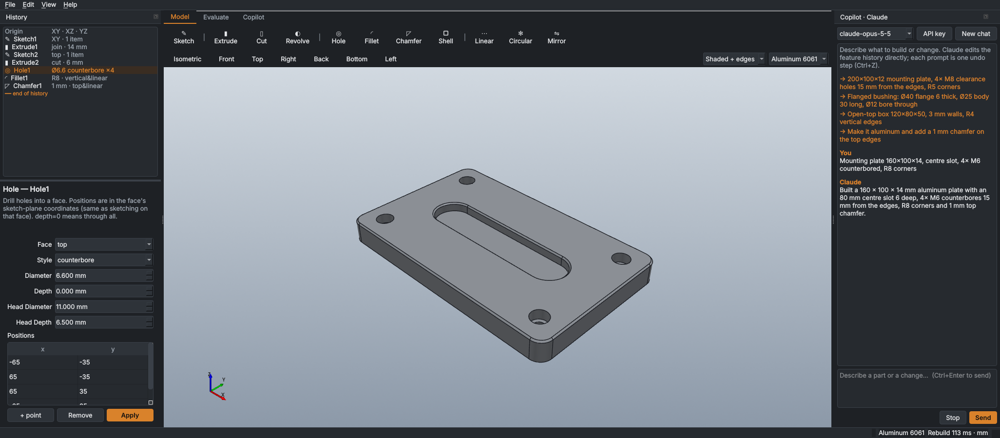

<p align="center">
  
</p>

<h1 align="center">Daedalus</h1>

<p align="center">
Parametric desktop CAD with an AI modelling copilot.<br>
Python · Qt (PySide6) · OpenCASCADE (build123d / OCP) · VTK
</p>

<p align="center"><b>v2.9.0</b> · Windows (also runs on Linux/macOS) · <a href="#version-history">Version history</a></p>

<p align="center"></p>

Daedalus covers the full path from sketch to shop floor: parts, assemblies, drawings, sheet metal, frames and HSS,
simulation (FEA, CFD, physics), CAM with G-code, quoting, and inventory. **Icarus**, the built-in copilot, models
through the same feature tools you use. It runs locally on Ollama by default, or on Claude. Daedalus also links to
SolidWorks, Fusion, Rhino, Inventor and Solid Edge.

Files save as `.daedalus` (JSON feature history). Formerly **Strata CAD**: `.strata` files open as before, and
settings are migrated on first launch.

---

## Contents
[Install](#install) · [Features](#features) · [Icarus copilot](#icarus-copilot) · [CAD Link](#cad-link) ·
[Keys & mouse](#keys--mouse) · [Tips](#tips) · [Architecture](#architecture) · [Development](#development) ·
[Version history](#version-history) · [Roadmap](#roadmap)

---

## Install

**Windows (recommended):** unzip, then double-click **`install.bat`**. It:
1. Finds or installs **Python 3.11 64-bit** for the current user. The sketch solver ships Windows wheels for 3.10/3.11 only.
2. Builds `.venv`, installs the requirements and pre-compiles the code.
3. Adds Desktop and Start-menu shortcuts.
4. Sets up Icarus: installs and starts Ollama, then downloads a model sized to your RAM (24 GB+ → `qwen2.5:14b`, 12 GB+ → 7b, else 3b).

Installer options: `-NoAgent`, `-AgentOnly`, `-Model <name>`, `-NoShortcut`, `-Yes`, `-CheckOnly`.
After installing, start Daedalus from the shortcut or with `run_windows.bat`.

**Manual install (any OS):**
```bash
py -3.11 -m venv .venv              # macOS/Linux: python3.11 -m venv .venv
.venv\Scripts\activate              # macOS/Linux: source .venv/bin/activate
pip install -r requirements.txt
pip install -r requirements-optional.txt   # CoACD (exact physics shapes), pywin32 (CAD Link) — optional
python -m daedalus                  # or: python -m daedalus part.daedalus
```

**Setup check:** run `python -m daedalus --check` (add `--json` for machine-readable output), or open
**Help ▸ Setup check**. It installs missing packages, starts Ollama and downloads models.

**Optional extras**
- **DWG:** install the free ODA File Converter; Daedalus finds it automatically. DXF, PDF, SVG and STEP need nothing extra.
- **Scanned handbooks:** install Tesseract OCR to add them to the Design Data reference library.
- **Claude:** click **API key** in the Icarus panel, or set `ANTHROPIC_API_KEY`. The model defaults to `claude-opus-5-5` (`DAEDALUS_MODEL` overrides it).

---

## Features

### Modelling
- **Feature history:** rollback bar, suppress, reorder, rename (references follow), and per-feature error isolation.
  Incremental rebuild means only features from the edit point down re-run.
- **Sketcher:**
  - Entities: lines, rectangles (5 kinds), slots (4), circles, arcs, polygons, ellipses, conics, splines, points, text with property fields, equation-driven curves.
  - Relations, smart dimensions, live solving, and DOF colouring.
  - Snaps that add relations automatically.
  - Tools: trim, extend, offset, fillet, chamfer, split, mirror, patterns, convert edges, move/rotate/scale, belt/chain.
- **3D sketch:** lines, splines and arcs on any plane or along X/Y/Z, with 3D snaps, relations and dimensions.
- **Features:**
  - Extrude (seven end conditions, two directions, draft), revolve, sweep (Frenet), loft, rib, draft, shell.
  - Hole wizard (M3–M24, #4-40–3/4-10), cosmetic and modelled threads.
  - Fillets (constant, variable, face, full-round) and chamfers (distance, distance-distance, distance-angle, vertex).
  - Linear, circular and mirror patterns; reference planes and axes.
- **Curves and surfaces:**
  - Curves: helix, spiral, spring, XYZ curve, projected and composite curves.
  - Surfaces: extruded, revolved, lofted, planar, offset and filled surfaces; knit, thicken, delete face.
- **Configurations and equations:** global variables, equations driving any parameter or sketch dimension, and a design table (.xlsx/.csv).
- **Sheet metal:**
  - Base and edge flanges, miter flanges, hems, sketched bends.
  - Gauge tables; K-factor, bend allowance or bend deduction; reliefs.
  - Forming tools (dimple, rib, louver, extruded hole).
  - Convert a shelled solid to sheet metal; fold/unfold; flat pattern to DXF.
- **Frames and HSS:**
  - Members along a 3D sketch, with mitred chains, coped T-joints, end caps, gussets, and a cut list with weights.
  - **HSS builder:**
    - Sizes: AISC/A500, CSA G40.20/21, EN 10219/10210, or any custom size and corner radius.
    - Section properties (A, I, S, Z, r, J) are within 1–2 % of the AISC Manual.
    - Inserts as a straight member or a frame.
- **Doodle to model:** draw or photograph a rough sketch, and Daedalus turns it into a constrained sketch offline, or Icarus models it.
- **Layers:** colour, visibility, lock and in-model flags per layer.

### Units and measure
- **Unit systems:**
  - SI: MMGS, mm·kg·N·MPa, MKS, CGS.
  - US customary: inch, fractional inch, foot.
  - Construction:
    - ft-in-fraction (`5'-6 1/4"`, slopes as x/12, plf, psf, kips, yd³);
    - decimal feet;
    - metric construction.
- **30+ measurement types**, each with its own unit, decimals and fraction rounding.
  You can switch in the status bar or under Edit ▸ Units, and there's a built-in unit converter.
- **Any field takes any unit or an expression:** `3' 4-1/2"`, `1/2"`, `25 mm + 2`, `45°`, `4/12`, `72°F`.
  Geometry is always stored exactly.
- **Measure panel:**
  - Points: distance, ΔX/ΔY/ΔZ, plan length, rise, slope.
  - Entities:
    - One edge or face: length, radius, arc angle, area, perimeter, tilt.
    - Two picks: min, centre, max and normal distance, plus angles.
    - More picks: totals.
  - Bodies: mass, weight, centre of mass, board feet.

### Assemblies
- **Objects and mates:** multiple bodies per file, each with its own history.
  - Standard mates: coincident, distance, parallel, perpendicular, angle, concentric, hinge, lock, tangent.
  - Advanced mates: limit distance and angle, width, symmetric, path.
  - Mechanical mates: gear, rack, screw, cam, slot.
  - Mates store geometry, not face numbers, so they survive design changes.
- **Subassemblies** (rigid or flexible, nested) and **component patterns** (linear, circular, mirror).
- **Moving parts:** Move (with snapping and SmartMates), rotate, turntable, orient, drop to floor, Drive a mate, interference check, exploded view.
- **Physics** (MuJoCo):
  - Gravity, contact and friction; mates become joints.
  - Motors, servos and springs.
  - Exact convex-piece collision shapes; playback with traces; "Keep position" writes a frame back to the model.

### Simulation
- **FEA** (quadratic tets, gmsh and scikit-fem):
  - Static, frequency, buckling, thermal (steady and transient), fatigue and harmonic studies.
  - Assembly static with bolt connectors; drop test; topology optimisation; design studies.
  - Checked against beam, column, torsion and conduction theory to within 1–6 %.
- **CFD** (lattice-Boltzmann): external drag and lift or internal flow; moving slices; streamlines.
- **Materials:** 60+ standard engineering materials with full properties, plus custom and per-object materials.
- **Design data:**
  - 27 machine-design calculators: shafts, keys, gears, couplings, clutches, brakes, fatigue, columns, contact, cylinders.
  - A searchable reference library for your own handbooks (OCR for scans).

### Drawings
- Sheets A4–A0 and Letter–ANSI E; first- or third-angle projection; automatic views with hidden lines.
- View types: section, detail, auxiliary, broken and flat-pattern.
- Annotation: dimensions (including ordinate), hole callouts, GD&T frames, datums, surface finish, balloons, parts list, revision table, title block.
- Export to vector PDF, DXF (R12–R2018), SVG, PNG and DWG.
- Edit DXF, DWG, SVG and HPGL files directly.

### Manufacturing
- **CAM:**
  - 2.5D operations: facing, pockets, profiles, spot, drill and tap.
  - Canned cycles: G73/74/76/81–89.
  - Posts: Fanuc, Haas, LinuxCNC, GRBL, Siemens 840D.
  - Machine from any side; cycle-time estimates.
- **Auto CAM:**
  - Analyses the part: holes, pockets, inside corners, reachable sides.
  - Picks tools from your lists and writes the whole program, including a second setup.
- **G-code backplot** for any `.nc`/`.tap`/`.mpf` file.
- **Quote:**
  - Machining and sheet/laser quotes from the exact model, with quantity breaks.
  - Machine schedule and quote history.
- **Manufacturability checks:** draft and undercut, wall thickness, 3D-print overhang.

### Data and files
- **Import:**
  - STEP assemblies (large files read in the background; a 1,600-part file loads in ~15 s), IGES, BREP, STL/OBJ/3MF (converted to solids).
  - DXF to an editable sketch.
  - SolidWorks `.sldprt`/`.sldasm` (through SolidWorks).
  - Up-axis detection on import.
- **Export:** STEP AP203/214/242 (names, colours, assemblies), IGES, BREP, STL, OBJ, 3MF, PLY, VRML and glTF/GLB, with auto-export on save.
- **Standard parts library:**
  - Your own reusable parts with versions and thumbnails; a team library on a shared drive.
  - Duplicate detection by geometry fingerprint; where-used.
  - Built-in ISO/ANSI fasteners and bearings.
- **Holocron inventory** (native):
  - Projects, production Gantt, locations, parts, vendors, reorder and shortages.
  - Excel import/export.
  - **Send BOM** turns a design into a project.
- **Import hub:** one search across projects, the standard library, inventory and fasteners, with linked or embedded imports.

### Interface
- **Layout:** Home screen with recent-file cards, a ribbon that adapts to the window width, a draggable δ tool hub, and sidebar islands you can rearrange.
- **Viewing:** six display modes; a view wheel (Space); section view; floor grid (G).
- **Selection:** SolidWorks-style part/face/edge selection with box select and hover highlight.
- **Themes and recovery:** Graphite or Black theme; autosave with crash recovery.

---

## Icarus copilot

Icarus edits the feature history through tools generated from the same feature registry the Inspector uses, so
anything you can build, it can build. Errors are fed back to it so it corrects itself, and one prompt is one undo step.

- **Ollama (local, default):** no key, no cost. Pull a tool-calling model (`qwen2.5:14b`, `qwen3:14b/32b`, `llama3.1:8b`), plus a vision model (`gemma3:12b`) for photos.
  The *Core* tool set (32 tools) suits small models; *All* exposes all 125.
- **Claude:** select it in the panel and enter an API key.
- **Inputs:** attach photos or drawings; an optional render check compares the result with your reference.
- **Engineering tools:** `design_calc`, `search_reference`, `hss_sizes`, `measure`, `convert_units`.
  Icarus converts what you say ("6 ft 4 1/2 in", "50 psf") into model units.

---

## CAD Link

Daedalus can act as an add-on to your main CAD program. Start it with **CAD Link ▸ …** or with a flag:
`--sw`, `--fusion`, `--rhino`, `--inventor` or `--solidedge`. Add `--demo` for a simulated session.

| | SolidWorks | Fusion | Rhino | Inventor | Solid Edge |
|---|---|---|---|---|---|
| Properties / BOM / inventory | ✓ | ✓ | ✓ (user text) | ✓ | ✓ |
| Library parts & fasteners (mated) | ✓ | ✓ (joints) | ✓ | ✓ | ✓ |
| Round trip (STEP + mates) | ✓ | ✓ | ✓ | ✓ | ✓ |
| Views, commands, macros | ✓ | ✓ | ✓ | ✓ | ✓ |

- **Link window:** a document tab, BOM and inventory, the library, a copilot, and a δ hotbar that floats over the CAD window.
- **Send between programs:** with two programs linked, Send to Fusion / Send to SolidWorks moves the document across with its properties.
- **SolidWorks setup:** `pip install pywin32`.
- **Fusion setup:**
  1. Run `python -m daedalus --install-fusion-addin`.
  2. In Fusion, run **DaedalusLink** from Add-Ins and tick *Run on Startup*.
  The add-in listens on 127.0.0.1 only, with a per-session token.
- **Rhino setup:** CAD Link ▸ Install Rhino link.
- **Mastercam for SolidWorks:** send the part with CAD Link ▸ From Daedalus, save it as .SLDPRT, then program it in SolidWorks.

**SolidWorks files without the Link:**
- With SolidWorks on the same PC (and pywin32), import `.sldprt`/`.sldasm` directly; parts and mates come across.
- With SolidWorks on another PC, run `python -m daedalus.io.swbridge <file>` there, then import here.
- With no SolidWorks at all, save as STEP AP214 in SolidWorks and import that.

> The COM and add-in bridges were written against the documented APIs and tested against mocks. The first session
> on a real install is the real test, and each failure names the API call involved.

---

## Keys & mouse

| Context | Keys |
|---|---|
| View | Middle-drag rotate · Ctrl+middle / right-drag pan · wheel zoom to cursor · Space view wheel · Ctrl+1…7 standard views · Ctrl+8 normal to · Shift+F zoom to selection · Alt+1…6 display mode · G floor grid · Ctrl+Shift+X section |
| Selection | Click part/face/edge (Ctrl toggle, Shift add) · drag left→right window, right→left crossing · Ctrl+Shift+P/F/E/J filter · H hide · Shift+H show all · I isolate · Esc clear |
| Sketch | S select · L line · R rectangle · C circle · A arc · G slot · O polygon · N spline · P point · D dimension · H/V · X construction · T trim · E extend · Ctrl+Enter finish |
| 3D sketch | L line · P spline · A arc · Tab next plane · X/Y/Z lock axis · right-click end chain |
| App | Ctrl+D drawing · Ctrl+I import · Ctrl+E export · Ctrl+L standard parts · Ctrl+Shift+I inventory · Ctrl+Alt+Q quote · Ctrl+Shift+W CAD Link · Ctrl+Shift+K Icarus panel · Ctrl+Shift+H tool hub · Ctrl+Shift+0 Home |

View ▸ Mouse ▸ Classic switches to left-drag rotate.

---

## Tips

- **Assemblies:** model each part at its own origin in its own object, keep one object fixed, then mate.
  A hinge is concentric plus a face mate; a slider is two face mates.
- **Simulation:**
  1. Set the material first.
  2. Add fixtures that stop all rigid motion.
  3. Refine the mesh where stresses concentrate until the peak stops changing.
- **Physics:**
  - Put a drive on the mate you want to power.
  - Check interference first, because overlapping parts are pushed apart violently.
- **Doodle:**
  - Ends within ~12 px are joined.
  - Set *Size* to the real longest side.
  - Dimension the sketch afterwards.
- **Units:** pick the unit system before drawing. Anything typed with a unit converts on entry.

---

## Architecture

```
daedalus/
  core/        features.py (registry: PARAMS drive the Inspector, file format and AI tools) · features2/3.py
               (reference geometry, loft, threads, curves, surfaces) · features_hss.py · sheetmetal*.py ·
               sketch2d.py / sketch3d.py (SolveSpace) · assembly.py (mates, LM/Gauss-Newton solver) ·
               document.py + doc_v28.py (history, rebuild cache, undo, configs, equations, units) ·
               units.py · hss.py · measure.py · materials.py · standards.py · physics.py (MuJoCo) · selectors.py
  sim/         FEA (gmsh + scikit-fem), fatigue, CFD (LBM, numba), assembly FEA, drop test, topology, studies
  drawing/     sheet model, HLR views, annotations (GD&T, ordinate, revisions), Qt render, DXF/DWG/SVG/HPGL
  manufacturing/  CAM toolpaths + posts, Auto CAM, quoting, printability
  design/      machine-design calculators, reference library (BM25 search)
  io/          importers/exporters, background STEP reader, SolidWorks bridge
  stdparts/    standard parts library, metadata, similarity, where-used
  inventory/   Holocron model, store, CAD sync
  sw/ fusion/ rhino/   CAD Link backends and add-ins
  ai/          tool schemas + executor, Claude and Ollama agent loops
  ui/          main window, viewport, sketchers, panels, dialogs
```

To add a feature, write one class in `core/`. It then shows up in the Inspector, the file format and Icarus's tools.

---

## Development

```bash
pip install pytest
QT_QPA_PLATFORM=offscreen pytest -q tests/     # 318 tests, ~1.5 min
```
GitHub Actions runs the suite on every push (`.github/workflows/tests.yml`).

**Design rule (not SolidWorks):** the workflow is familiar, but the naming, layout, visuals and file format are
Daedalus's own. No SolidWorks code, icons, assets or trade dress are used — don't add any.

---

## Version history

| Version | Highlights |
|---|---|
| **2.9.0** | Unit systems (SI, US customary, construction ft-in), any-unit input, unit converter · Measure panel (points, entities, bodies) · HSS builder (AISC, CSA, EN, custom) · cut-list weights |
| 2.8.2 | Speed: edits on large models 6–15× faster (300 parts: edit 1.34 s → 0.09 s, undo 1.35 s → 0.10 s), redraw 230 → 25 ms, faster start-up |
| 2.8.1 | Design Data: 27 calculators + searchable handbook library |
| 2.8 | Configurations and equations · subassemblies and component patterns · curves, helix, spring, modelled threads · fillet/chamfer/extrude options · GD&T, ordinate dims, revision table, auxiliary and broken views · advanced and mechanical mates · miter flange, sketched bend, convert, forming tools · surfaces |
| 2.7 | Full sketch entity set (rectangle/slot/arc/ellipse/conic/spline flyouts, text, equation curves) and sketch tools |
| 2.6 – 2.6.2 | FXAA and big-model speed-ups · floor grid · sidebar islands · Icarus name and logo · Rhino, Inventor and Solid Edge links · Windows installer and setup check · sketch-plane chooser |
| 2.5 – 2.5.1 | Auto CAM · canvas selection filter and hover highlight · teal accent |
| 2.4 – 2.4.3 | Native quoting and machine schedule · G-code backplot · Siemens post · canned cycles · adaptive toolbars · up-axis on import · SolidWorks part names in STEP |
| 2.3 – 2.3.4 | Display modes · SolidWorks-style selection and mouse · view wheel · section view · face and edge selection drive fillet/chamfer/shell · CAD Link reconnect and diagnostics |
| 2.2 | Large STEP files in the background (36 MB / 1,620 parts in ~15 s), mesh cache · 40 % faster start-up · Home screen · autosave and recovery |
| 2.1 | Fusion link · two-way SolidWorks ⇄ Fusion transfer |
| 2.0 | SolidWorks Link: BOM and inventory, library, copilot, δ hotbar, round trip |
| 1.12 | Local copilot on Ollama |
| 1.11 | Import hub |
| 1.10 | Rotate, turntable, orient, drop to floor |
| 1.9 | Full design tree |
| 1.8 | δ tool hub · Claude panel toggle |
| 1.7 – 1.7.2 | Black theme · incremental rebuild and vectorised snapping |
| 1.6 | Dark interface, Phosphor icons |
| 1.0 | Reference geometry, loft/rib/draft/thread · sheet metal · parts library, hole wizard, BOM · 2D drawings and DXF/DWG · CAM and G-code · assembly FEA, drop test, topology |
| 0.9 | Materials · FEA (static, modal, buckling, thermal, fatigue, harmonic) · CFD |
| 0.8 | Rigid-body physics |
| 0.7 | Import/export: STEP assemblies, IGES, meshes, DXF, SolidWorks bridge |
| 0.6 | Multiple objects, mates, constrained motion |
| 0.5 | Layers |
| 0.4 | Doodle / photo to model |
| 0.3 | 3D sketch, sweep, frames with cut list |
| 0.2 | Constrained 2D sketcher |

Release notes and the user guide (PDF) are on the [Releases](../../releases) page.

---

## Roadmap

- Live link to game engines (Godot / Unity): meshes, joints from mates, colliders.
- Contact (no-penetration) FEA and nonlinear materials.
- 3D adaptive CAM.
- Background rebuild thread with progress for heavy parts.
- Selection-aware prompts ("fillet these"); 3D doodle for frame layouts.
